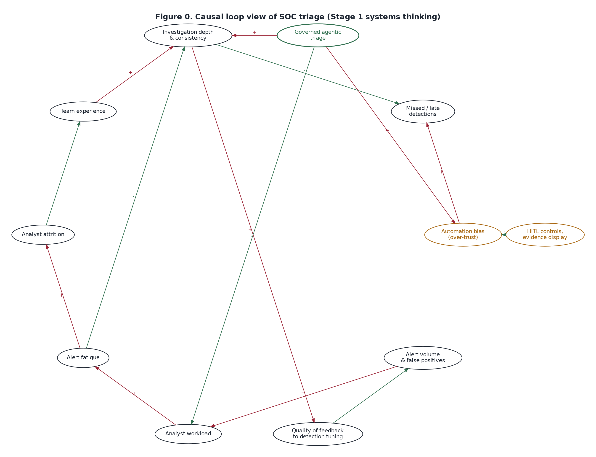

# Stage 1: Structured Thinking, STOIC Prompt Engineering and Research

**Project:** Governed Agentic AI for SOC Alert Triage and Incident Investigation

> **Team action before submission:** this document reads STOIC as **S**ituation, **T**ask, **O**bjective, **I**nputs, **C**onstraints. If the class used different words for any letter, rename the headings in section 3; the content of each block still applies.

## 1. Problem framing

A Security Operations Centre (SOC) receives far more alerts than its analysts can examine properly. Each alert has to be correlated with other events, checked against threat intelligence, placed in the context of the affected asset and user, prioritised, and then closed, investigated further or escalated.

Today this is mostly manual work spread across several consoles, which makes it slow, inconsistent between analysts and shifts, and hard to audit.

A survey of 282 security leaders found that the median SOC handles about 960 alerts a day and that roughly 40% are never investigated. Fully investigating one alert takes about 70 minutes on average, and 61% of teams admitted ignoring alerts that later proved critical [R1]. The 2025 SANS Detection and Response Survey found that 73% of teams name false positives as their biggest detection challenge [R2].

**Problem statement (team wording):** *How might a SOC triage every alert consistently and quickly, with evidence-backed recommendations, while keeping humans in control of every high-impact decision and leaving a complete audit trail?*

## 2. Critical thinking

### 2.1 Claims, evidence and assumptions

| Claim | Evidence | Assumption we are making | How we test it |
|---|---|---|---|
| Triage is the main bottleneck, not detection | Survey data on uninvestigated alerts and time per alert [R1]; internship experience of L1 monitoring on Wazuh | The same holds for mid-size Indian SOCs and MSSPs | Expert interview, Q1 and Q3 |
| Most triage time goes on gathering context, not judgement | Analysts pivot across SIEM, EDR, TI portals and CMDB for each alert | Context sources can be queried programmatically | PoC tool lookups; expert Q2 and Q4 |
| AI can do the gathering and the first assessment | LLMs can summarise and reason over structured evidence | Small open-weight models produce valid structured output often enough | Model benchmark: JSON compliance, hallucinated IDs |
| Humans must stay in control of response actions | Containment errors cause outages or tip off attackers; regulators expect accountability | Approval friction is acceptable if the approval is fast and well informed | HITL design; expert feedback on approval tiers |
| An LLM recommendation can be trusted | **Not assumed.** Models hallucinate and can be manipulated by text inside alerts | Deterministic code, not the model, must make routing and scoring decisions | Guardrail tests: injection, invented evidence IDs |

### 2.2 Five Whys: why are critical alerts missed?

1. Why are critical alerts missed? Analysts do not reach them, or close them too quickly.
2. Why? The queue is longer than the team's capacity, so alerts are skimmed.
3. Why? Each alert takes a long time because context sits in five or more separate tools.
4. Why? There is no single case record that assembles evidence automatically.
5. Why? The tools were bought separately and triage is still organised around people, not around the evidence.

**Root cause:** evidence assembly is manual and fragmented. That is the step to automate, while judgement on high-impact actions stays with humans.

### 2.3 Biases and risks we checked our thinking against

- **Automation bias:** analysts may approve whatever the AI suggests. In response, the console shows the evidence and score breakdown before the recommendation, and rejecting requires a reason code.
- **Solutionism:** "add AI" is not a goal in itself. We screened non-AI options too (section 4).
- **Availability bias:** dramatic incidents dominate memory, but most alerts are benign. The design must close benign alerts safely, not only escalate.
- **Adversarial thinking:** attackers can write into logs, so alert text must be treated as data, never as instructions to the model.

## 3. Systems thinking

**System elements:**

- **Detection tools:** SIEM, EDR, IDS and email security.
- **Context sources:** threat intelligence, CMDB, identity directory and alert history.
- **People:** L1/L2 analysts, the IR lead, IT and asset owners, and the CISO.
- **Rules:** playbooks, SLAs and regulatory reporting duties. In India these include CERT-In incident reporting and, for regulated entities, RBI expectations.

**Feedback loops (Figure 0, `diagrams/fig0_causal_loop.png`):**

- **R1, fatigue spiral (reinforcing):** alert volume → workload → fatigue → attrition → less experience → shallower investigation → more missed detections.
- **R2, noise spiral (reinforcing):** shallow investigation → poor feedback to detection tuning → more false positives → more volume.
- **B1, agentic triage (balancing):** automated evidence assembly lowers workload and raises consistency.
- **B2, automation-bias risk (balancing):** agentic triage can create over-trust. This is counteracted by HITL controls and showing the evidence behind each recommendation.

**Leverage points:**

1. Automate evidence assembly and the first assessment. This is the highest leverage.
2. Make routing deterministic and auditable.
3. Feed structured outcomes back into detection tuning (future work).

**Unintended consequences to design against:**

- Deskilling of junior analysts. The console therefore explains reasoning and cites evidence.
- Attackers adapting through prompt injection.
- Over-reliance on one model vendor. The design therefore uses swappable open-weight models.

## 4. STOIC prompt engineering and refinement

### 4.1 Brainstorming prompt: version 1 (unstructured)

> Give me ideas to use AI in a SOC.

**Result (summarised):** generic ideas such as "AI chatbot for analysts", "use ML for anomaly detection" and "automate everything". They had no context, no constraints and no way to compare them.

### 4.2 Version 2 (STOIC)

> **Situation:** We are MBA (IT Business Management) students designing a proof of concept for a mid-size SOC that monitors about 1,000 alerts a day with a small L1/L2 team, using a SIEM such as Wazuh.
> **Task:** Generate 8 distinct ideas for using agentic AI in alert triage and incident investigation.
> **Objective:** Find the idea that most reduces time-to-triage without removing human control of response actions.
> **Inputs:** The current process (alert → manual enrichment → decision → escalation), our tools (n8n, Streamlit, open-weight LLMs) and the brief's requirement for HITL, escalation and guardrails.
> **Constraints:** Buildable by a small student team within the hackathon timeline; synthetic data only; no autonomous containment; open-weight models only; each idea in one line with the main risk.

**Result:** eight concrete ideas with risks (section 5). It was still weak on how to compare them.

### 4.3 Version 3 (refined STOIC, adds evaluation criteria and output format)

> Same Situation and Inputs.
> **Task:** For each of the 8 ideas, score Usefulness, Realism and Feasibility from 1 to 5 with a one-line justification, and name the human decision point.
> **Objective:** Pick one idea for the PoC and justify it against the others.
> **Constraints:** Use only the given scale; flag any score that depends on an assumption; return a table, then a 5-line recommendation.

**What changed and why:**

- **v1 → v2:** added the situation and constraints. This made the ideas specific and feasible.
- **v2 → v3:** added scoring criteria and an output format. This made the ideas comparable and the choice defensible.
- **v3 output:** the screening table below. The team adjusted two scores after discussion: the "auto-containment bot" lost realism because of governance risk.

### 4.4 STOIC carried into the agent prompts

Each agent prompt in `prompts/` follows the same discipline:

- **Situation:** a shared block saying the agent is one component of a governed SOC, all data is synthetic, and it advises but never acts.
- **Task:** the instructions.
- **Objective:** a stated objective per agent.
- **Inputs:** the case evidence, delimited inside `<evidence>`.
- **Constraints:** treat evidence as data, cite only supplied evidence IDs, and return one JSON object matching the schema.

The prompts are versioned (`v1.0`), and each version is recorded on every case, so that any later prompt change can be compared through the benchmark.

## 5. Idea generation and screening

Scores are 1–5. The total weights Usefulness 40%, Realism 30% and Feasibility 30%.

| # | Idea | Usefulness | Realism | Feasibility | Weighted | Main risk |
|---|---|---|---|---|---|---|
| 1 | **Multi-agent triage: correlation, TI, asset context, risk, summary; with HITL** | 5 | 4 | 4 | **4.4** | Hallucinated evidence. Mitigated by the evidence-ID check |
| 2 | Analyst chatbot over the SIEM ("ask your logs") | 3 | 4 | 4 | 3.6 | Answers lack audit trail and consistency |
| 3 | Auto-containment bot (isolates hosts automatically) | 4 | 2 | 3 | 3.1 | Unsafe autonomous action; outage risk |
| 4 | LLM-written detection rules | 3 | 3 | 3 | 3.0 | Needs a large detection-engineering dataset |
| 5 | Phishing-email triage agent only | 3 | 4 | 4 | 3.6 | Narrow scope; covers one alert type |
| 6 | Shift-handover summariser | 2 | 5 | 5 | 3.8 | Low impact on the core bottleneck |
| 7 | Threat-hunting assistant | 3 | 3 | 2 | 2.7 | Needs rich historical data |
| 8 | Classic rule-based SOAR playbooks (no AI) | 3 | 5 | 4 | 3.9 | Brittle on ambiguous alerts; no reasoning |

**Selected: idea 1.** It attacks the root cause (manual, fragmented evidence assembly) and covers every alert type. It maps directly onto the brief's illustrative flow and keeps humans in control of actions.

Two other ideas are folded into it rather than discarded:

- Idea 8 is used for the deterministic parts: validation, scoring and routing.
- Idea 3 survives only as *simulated, approval-gated* actions.

## 6. Market research

**Demand signals:**

- Alert volumes exceed analyst capacity [R1].
- False positives are the top detection challenge [R2].
- Vendors now market "AI SOC" or agentic triage as a distinct category.

| Category | Examples | What they do | Gap for our context |
|---|---|---|---|
| AI assistants inside security platforms | Microsoft Security Copilot, Google Security Operations with Gemini, CrowdStrike Charlotte AI | Natural-language investigation, summaries, guided response inside the vendor's ecosystem | Tied to one vendor's stack and licensing; proprietary models; limited control over thresholds |
| SOAR and no-code security automation | Splunk SOAR, Palo Alto Cortex XSOAR, Tines, Torq | Playbook-driven enrichment and response, increasingly with AI steps | Playbooks are brittle on ambiguous alerts; strong but costly platforms |
| Autonomous "AI SOC analyst" products | Dropzone AI, Prophet Security, D3 Security and others | Agentic investigation of every alert with a verdict | Closed models and logic; cloud data processing; cost for mid-size Indian firms |
| Open-source building blocks | Wazuh (SIEM/XDR), TheHive (case management), Shuffle (SOAR), MISP (threat intelligence) | Detection, cases, automation and TI at low cost | No agentic reasoning layer; integration effort |

**Positioning of our PoC:** an open, governed reference design for mid-size SOCs and MSSPs, built from open-weight models and an open orchestration tool. It has explicit HITL tiers and a guardrail-to-framework mapping that a GRC team can audit, which matters in India's regulated sectors under the DPDP Act, CERT-In directions and RBI expectations.

> Product names are given as category examples from public vendor material. Do not attribute specific features or figures to a vendor in the report without checking its current documentation.

## 7. Technology research and choices

| Decision | Options considered | Choice | Reason |
|---|---|---|---|
| Orchestration | n8n, LangGraph, CrewAI, Power Automate | **n8n** | Named in the brief; visual workflows suit screenshots and non-developer review; webhooks, branching, error workflows and data tables built in |
| UI/UX | Streamlit, Lovable, Replit, Flask | **Streamlit** | Python, fast to build, good for case views and charts; runs locally |
| Models | Qwen, Llama, Mistral, Gemma, GPT-OSS, DeepSeek | **GPT-OSS 20B and 120B, Qwen 3.8 27B** (Groq); Llama 3.3 70B optional; Ollama models as the local alternative | All open-weight; available on a free hosted tier, so no GPU is needed; same prompts and schema for all |
| Structured output | Free text, JSON mode, function calling | **JSON mode + strict schema validation in code + one corrective retry** | Measurable compliance; failures route to humans |
| Guardrails | LLM-as-judge, guardrail libraries, deterministic code | **Deterministic code outside the model** | Predictable, testable, auditable; the model cannot argue its way past them |
| Data store | Google Sheets, Postgres, n8n Data Tables | **n8n Data Tables** | No credentials; part of n8n; enough for the PoC |

## 8. Opportunity justification

**Chosen process:** first-line SOC alert triage and initial investigation, from alert intake to a recommended disposition and human decision.

**Why this process:**

- **High volume and repetitive:** strong automation value.
- **Evidence-heavy:** well suited to AI summarising and reasoning over structured context.
- **Clear decision points:** natural places for HITL.
- **Measurable:** triage time, coverage, false positives and escalation accuracy.

**Value hypotheses for expert validation (not measured claims):**

- Raise the share of alerts that get a structured first assessment towards 100%.
- Cut evidence-gathering time per alert from tens of minutes to minutes.
- Make dispositions consistent across analysts and shifts.
- Give auditors a complete decision trail.

**Why agentic rather than a single prompt:** specialised agents with narrow inputs and outputs are easier to validate, swap and audit. The orchestrator stays deterministic, so routing never depends on one model's free-form judgement.

## References

- [R1] The Hacker News, "The State of AI in the SOC 2025: Insights from Recent Study", 29 Sep 2025 (survey of 282 security leaders). https://thehackernews.com/2025/09/the-state-of-ai-in-soc-2025-insights.html
- [R2] SANS 2025 Detection and Response Survey, as reported in LMNTRIX, "Alert Fatigue and the SOC Noise Crisis", 2026. https://lmntrix.com/blog/alert-fatigue-and-the-soc-noise-crisis-why-more-alerts-isnt-more-security/ (cite the SANS report directly if you can access it)
- NIST AI Risk Management Framework 1.0 (NIST AI 100-1); ISO/IEC 42001:2023; ISO/IEC 27001:2022 (see Stage 4).
