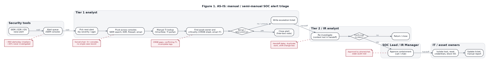
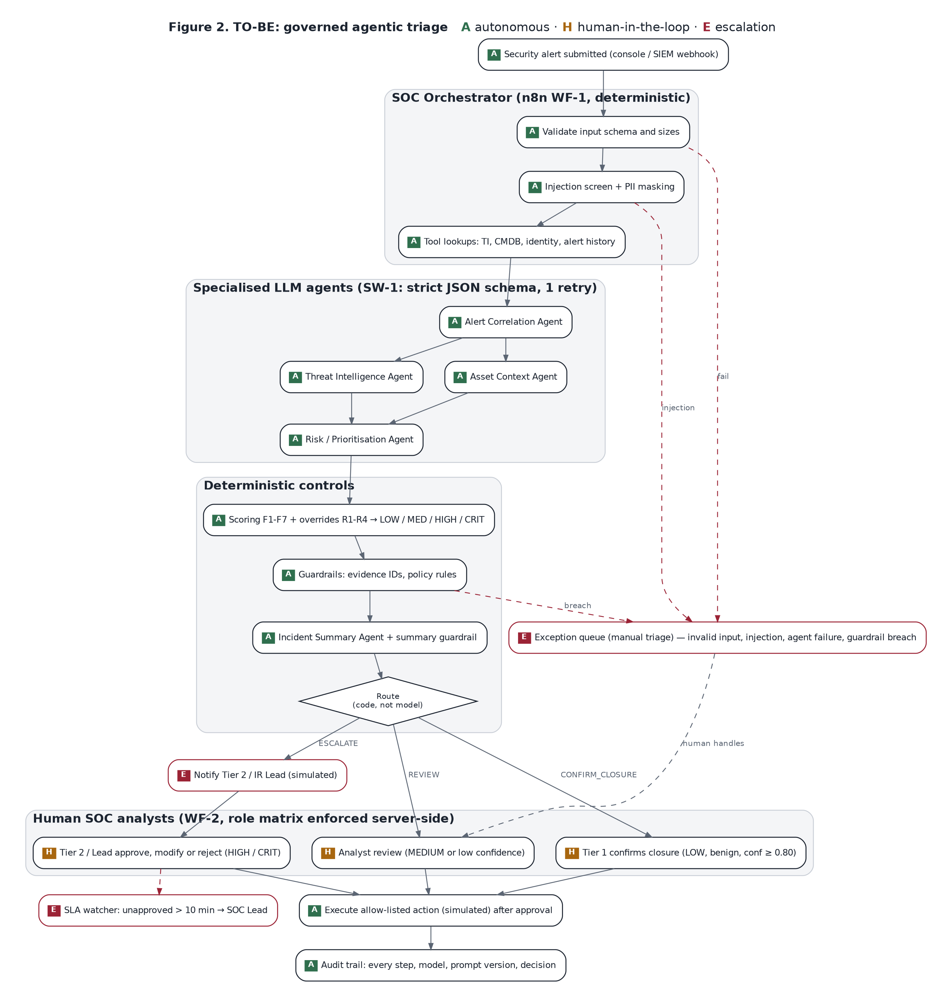
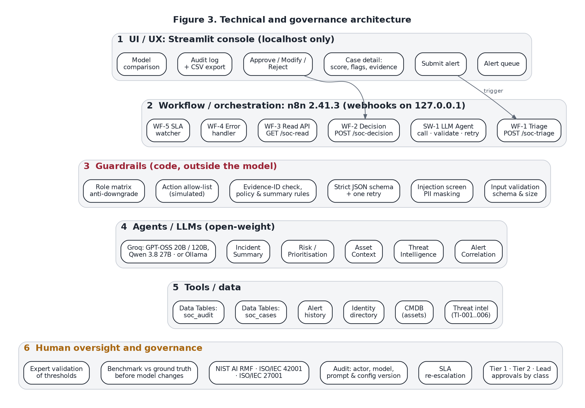

# Stage 2: Process Mapping and Agentic AI Architecture

The three required diagrams are in `docs/diagrams/`, each as PNG for the report and SVG for the website. To regenerate them, run `python docs/diagrams/make_diagrams.py` (needs Graphviz).

| Figure | File | Shows |
|---|---|---|
| 1 | `fig1_as_is.png` | AS-IS manual process: actors, activities, systems, decisions, handoffs, pain points |
| 2 | `fig2_to_be.png` | TO-BE governed agentic process, every activity marked **A** / **H** / **E** |
| 3 | `fig3_architecture.png` | Technical and governance architecture in six layers |

## 1. AS-IS process (Figure 1)

| Step | Actor | Activity | System | Decision / handoff | Delay, bottleneck or exception |
|---|---|---|---|---|---|
| 1 | Security tools | Raise alert | SIEM / EDR / IDS | Into a shared queue | Volume above capacity; about 40% of alerts never investigated [Stage 1, R1] |
| 2 | Tier 1 analyst | Pick the next alert by severity or age | SIEM console | None | Waiting time in the queue; high-severity noise crowds out real signals |
| 3 | Tier 1 | Pivot across consoles to collect related events | SIEM search, EDR, firewall, email gateway | None | "Swivel-chair" work; no single case record |
| 4 | Tier 1 | Look up IPs, hashes and domains | TI portals (e.g. VirusTotal) | None | Manual copy and paste; sources may conflict |
| 5 | Tier 1 | Find asset owner, criticality and user privilege | CMDB spreadsheet, directory, email to IT | **Handoff** to IT for missing data | CMDB gaps; waiting for replies |
| 6 | Tier 1 | Decide whether it is benign or a false positive | Judgement | **Decision**: close, or escalate when unsure | Inconsistent between analysts and shifts |
| 7 | Tier 1 | Close the alert with a free-text note, or write an escalation ticket | Ticketing | **Handoff** to Tier 2 | Context lost; notes vary in quality |
| 8 | Tier 2 / IR | Re-investigate | Same consoles again | **Decision**: confirmed incident? | Duplicate work; shift-change loss |
| 9 | SOC Lead / IR Manager | Approve containment | Phone or chat | **Approval**, then **handoff** to IT | Approvals with a weak audit trail; out-of-hours delay |
| 10 | IT / asset owner | Isolate host, reset credentials, block IOC | EDR, AD, firewall | None | Manual and slow; errors can cause outages |
| 11 | Analyst | Update ticket, write report | Ticketing | None | Manual, inconsistent documentation |

**Exceptions in the AS-IS process:** incomplete or missing logs, assets not in the CMDB, conflicting TI verdicts, alerts arriving during shift change, and alert text that looks deliberately crafted. All of these are handled ad hoc, by individual judgement.

## 2. TO-BE governed agentic process (Figure 2)

**Legend:**

- **A, Autonomous:** done by code or an AI agent, with no human needed at that step.
- **H, Human-in-the-loop:** needs a human decision.
- **E, Escalation:** the case is pushed to a higher authority or a manual queue.

| # | Activity | Performed by | Mode | Output | PoC component |
|---|---|---|---|---|---|
| 1 | Alert submitted | SIEM webhook or console | **A** | Case created, audit row | WF-1 webhook `/soc-triage` |
| 2 | Validate input schema and sizes | Orchestrator (code) | **A** | Pass, or exception | Validate Input |
| 3 | Screen for prompt injection; mask PII | Orchestrator (code) | **A** | Clean, masked alert, or exception | Injection & PII Screen |
| 4 | Extract entities; look up TI, CMDB, identity, history | Orchestrator tools (code) | **A** | Evidence set with IDs | Tool nodes |
| 5 | Correlate related events and history | Alert Correlation Agent | **A** | Related evidence, pattern, gaps | SW-1, prompt `corr_v1.0` |
| 6 | Interpret threat intelligence | Threat Intelligence Agent | **A** | TI verdict, conflicts, confidence | SW-1, prompt `ti_v1.0` |
| 7 | Assess asset and identity impact | Asset Context Agent | **A** | Criticality, sensitivity, privilege | SW-1, prompt `asset_v1.0` |
| 8 | Propose classification and action | Risk / Prioritisation Agent | **A** | Behaviour level, proposal, reasons with evidence IDs | SW-1, prompt `risk_v1.0` |
| 9 | Compute score and class; apply overrides R1–R4 | Scoring engine (code) | **A** | Score 0–100, LOW / MEDIUM / HIGH / CRITICAL, flags | Scoring Engine |
| 10 | Check evidence IDs and policy rules | Guardrails (code) | **A** → **E** on breach | Pass, or exception | Policy & Output Guardrails |
| 11 | Write incident summary; check it | Incident Summary Agent + guardrail | **A** → **E** on breach | Analyst-ready summary | Summary Guardrail |
| 12 | Route the case | Orchestrator (code) | **A** | CONFIRM_CLOSURE / REVIEW / ESCALATE / EXCEPTION | Route switch |
| 13 | Confirm closure (LOW, benign, confidence ≥ 0.80) | Tier 1 analyst | **H** | Closed (simulated) | WF-2 |
| 14 | Review (MEDIUM or low confidence) | Tier 1 or Tier 2 analyst | **H** | Approve, modify or reject | WF-2 |
| 15 | Notify IR lead for HIGH or CRITICAL | Orchestrator | **E** | Notification (simulated) | Notify IR Lead |
| 16 | Approve containment (HIGH / CRITICAL) | Tier 2 (HIGH) or SOC Lead (CRITICAL) | **H** | Approve, modify or reject | WF-2 role matrix |
| 17 | Re-escalate unapproved escalations | SLA watcher | **E** | SOC Lead alerted after 10 min | WF-5 |
| 18 | Handle exceptions manually | Analyst | **E** → **H** | Manual triage, reason recorded | Exception queue |
| 19 | Execute the approved allow-listed action | Orchestrator | **A** (after **H**) | Simulated action, ticket number | WF-2 |
| 20 | Record every step | Orchestrator | **A** | Audit row with actor, model, prompt version | `soc_audit` table |

### 2.1 Agent roles

| Agent | Receives | Returns (strict JSON) | Cannot |
|---|---|---|---|
| Alert Correlation | Alert, related history, extracted entities | Related evidence IDs, attack pattern, missing evidence, confidence | Invent events; read anything outside the evidence |
| Threat Intelligence | TI records for this case's indicators | Verdict per indicator, conflicts, confidence | Use outside knowledge about IPs or domains |
| Asset Context | CMDB and identity records | Asset criticality, data sensitivity, user privilege, gaps | Assume a missing asset is low-risk |
| Risk / Prioritisation | Outputs of the three agents above + alert | Behaviour level, proposed class, category, one action, reasons with evidence IDs | Set the final score or route; act |
| Incident Summary | Everything above + the code's score and route | Analyst-ready summary, action options marked `requires_approval` | Claim an action has been taken |

### 2.2 HITL and escalation matrix

| Case class (from code) | Route | Who decides | May approve containment | Escalation |
|---|---|---|---|---|
| LOW, benign, confidence ≥ 0.80 | Closure confirmation | Tier 1 | No | None |
| LOW without a benign explanation or with confidence < 0.80; any MEDIUM | Analyst review | Tier 1 (up to MEDIUM) | No | Tier 2 if the analyst is unsure |
| HIGH | Escalate | Tier 2 or Lead | Yes | IR Lead notified; SLA re-escalation |
| CRITICAL | Escalate | SOC Lead only | Yes, including isolating critical assets | IR Lead notified; SLA re-escalation |
| Any exception | Exception queue | Tier 2 for HIGH/CRITICAL/unknown, otherwise Tier 1 | Only with an explicit action (no AI recommendation to approve) | Manual |

The governing class for a decision is the higher of the original and any modified class. An analyst therefore cannot lower a case's class in order to approve it themselves.

## 3. Technical and governance architecture (Figure 3)

| Layer | Components | Governance role |
|---|---|---|
| 1 UI / UX | Streamlit console: queue, submit, case detail, decision form, audit log, model comparison | Puts evidence before the recommendation; captures reason codes; local only |
| 2 Orchestration | n8n WF-1 triage, SW-1 agent caller, WF-2 decision, WF-3 read API, WF-4 error handler, WF-5 SLA watcher | Deterministic routing; every path ends in a human queue or a recorded state |
| 3 Guardrails | Validation, injection screen, PII masking, schema and retry, evidence-ID check, policy and summary rules, allow-list, role matrix | Controls the model cannot override |
| 4 Agents / LLMs | Five agents with versioned prompts; GPT-OSS 20B/120B and Qwen 3.8 27B on Groq, or local Ollama models | Swappable models; same prompts and schema for a fair comparison |
| 5 Tools / data | TI, CMDB, identity, alert history; `soc_cases` and `soc_audit` tables | Evidence IDs make every claim traceable; synthetic data only |
| 6 Oversight and governance | Tier 1 / Tier 2 / Lead approvals, SLA re-escalation, audit trail, framework mapping, benchmark, expert validation | Accountability and continuous assurance (Stage 4) |
